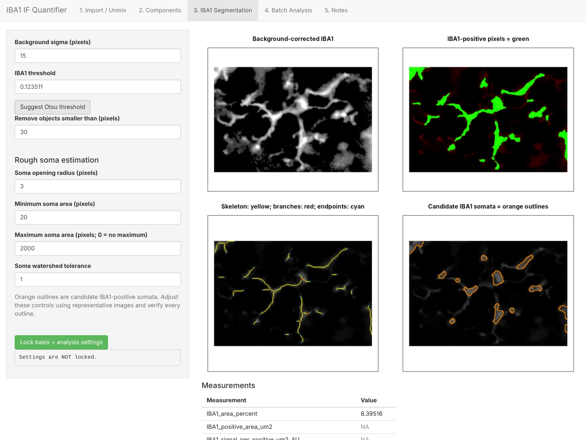

# Glia IF Quantifier: GFAP & IBA1 R Shiny apps

Two **R Shiny** apps for quantifying **astrocytes (GFAP)** and **microglia (IBA1)** in immunofluorescence images. They read multispectral **Nuance `.im3` cubes**, unmix the channels, and measure marker area, intensity, skeleton morphology and, for IBA1, rough soma counts across a whole batch with locked settings. Composite TIFF/JPG/PNG images work too.



---

## ✨ Features
- **Spectral unmixing** of `.im3` cubes, either with a reference spectral library (NNLS) or library-free (NMF)
- **Interactive setup**: assign marker, DAPI and autofluorescence components; background correction; Otsu-suggested threshold
- **Lock-and-batch workflow**: settings are fixed on a representative image, then applied identically to every image
- **Measurements**: marker area %, intensity, DAPI nuclei, skeleton length, branch points and endpoints, plus soma count, size and density (IBA1)
- **Exports**: 16-bit TIFF channels, masks, skeleton and soma QC overlays, composites with scale bar, CSV, and everything bundled in a ZIP
- **Validated skeleton measurements**: exact branch-point and endpoint counts on images with known answers ([validation](validation/VALIDATION.md))

## 🚀 Quick start
1. Install the packages once, in RStudio with this folder as the working directory:
   ```r
   source("setup/install_packages.R")
   ```
2. **For `.im3` files**, unzip a Java JDK into your Downloads folder. The apps find it automatically ([how](docs/user_guide.md#java-only-needed-for-nuance-im3-files)).
3. **Session → Restart R**, open `apps/IBA1_IF_Quantifier/app.R` or `apps/GFAP_IF_Quantifier/app.R`, and click **Run App**.
4. Work through the tabs: **Import/Unmix → Components → Segmentation → Lock → Batch Analysis → Download**.

Full step-by-step instructions with screenshots: **[docs/user_guide.md](docs/user_guide.md)**

## 📏 Outputs
One CSV row per image, with area and intensity (primary outcomes), DAPI nuclei, skeleton length, branch points, endpoints, network fragments, and for IBA1, soma count, area and density, and per-soma averages. Column definitions are in **[docs/measurements.md](docs/measurements.md)**.

## ✅ Validation
| Test | Result after the Nov 2026 fix |
|---|---|
| Images with known answers (shapes, microglia, crossings, noisy) | Endpoints and branch points **exact (8/8)**; length within 1.1% |
| Dense networks vs. Fiji AnalyzeSkeleton | Branch points 14–15% lower, length 7–8% lower. Endpoints are closer to the true tip counts than Fiji's. |
| Real Iba1 images vs. hand annotations (CellMorph) | Skeleton within ~1–2 px of hand-traced processes; soma estimates only partly match (rough) |
| Full app run in a browser | All tabs, batch and ZIP export work; GFAP area and nuclei exact on test image |

Before the fix, branch points were overcounted 3–9× and length by 17–43%. Details and how to re-run: **[validation/VALIDATION.md](validation/VALIDATION.md)**.

## 📁 Repository structure
```
├── apps/
│   ├── GFAP_IF_Quantifier/app.R
│   └── IBA1_IF_Quantifier/app.R
├── setup/
│   ├── install_packages.R        # one-time package installation
│   └── java_check.R              # confirms Java works for .im3 files
├── docs/
│   ├── user_guide.md             # step-by-step instructions
│   ├── measurements.md           # what every CSV column means
│   └── screenshots/
├── example_data/
│   ├── cellmorph/                # 2 real Iba1 images + hand annotations (CC BY 4.0)
│   └── synthetic/                # test images with known answers
├── validation/
│   ├── VALIDATION.md             # validation report
│   ├── test_morphology.R         # re-runs the validation on the app code
│   ├── dense_fields/             # Fiji comparison images
│   └── original_apps/            # pre-fix versions, for comparison
└── CHANGELOG.md
```

## ⚠️ Notes
- Use **one locked set of settings** for all images and groups, and check the QC overlays from every group.
- Skeleton and soma values are **field-level descriptors**, not cell-by-cell tracing.
- Use animals as biological replicates.

## 🛠️ Built with
R · Shiny · EBImage · RBioFormats · DT · ggplot2 · developed with AI-assisted coding

## 📖 Data credit
Example Iba1 images: Ling, H. (2026). *CellMorph dataset* (v1). Zenodo. https://doi.org/10.5281/zenodo.23585259 (CC BY 4.0).

## 👩🏾‍🔬 Author
**Elizabeth Etafo**, Ph.D. candidate, Pharmaceutical Sciences, University of Nebraska Medical Center
[elizabethetafo.com](https://elizabethetafo.com) · [LinkedIn](https://www.linkedin.com/in/eetafo/)
