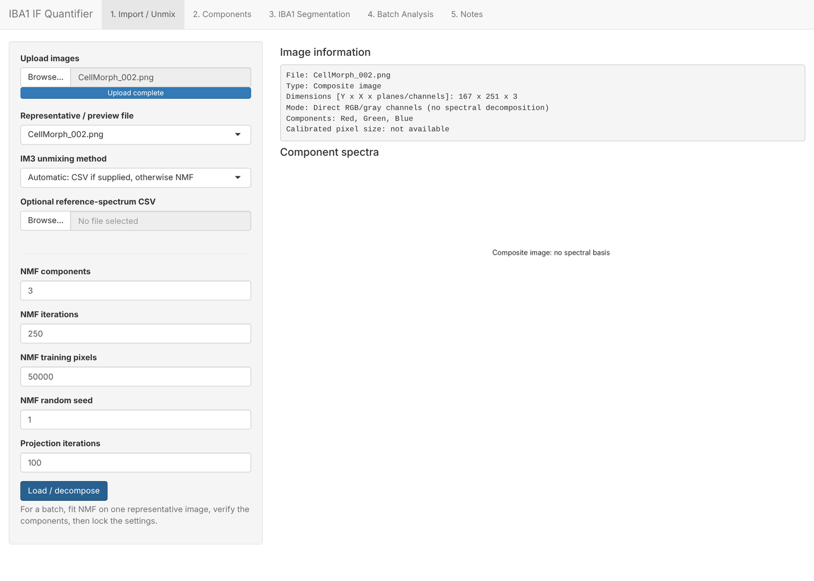
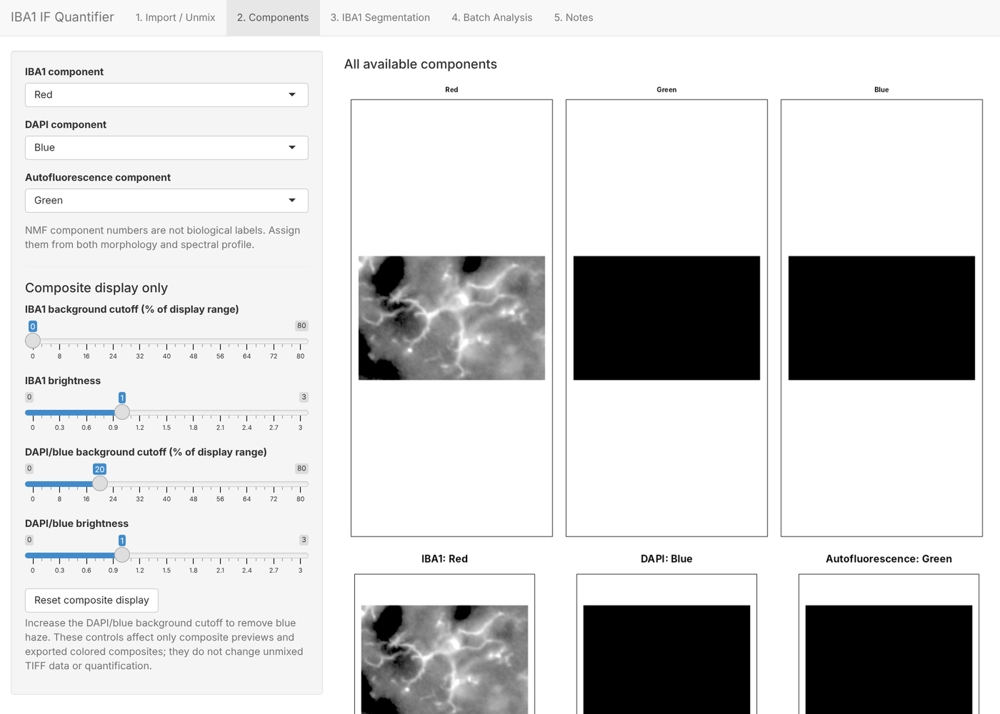
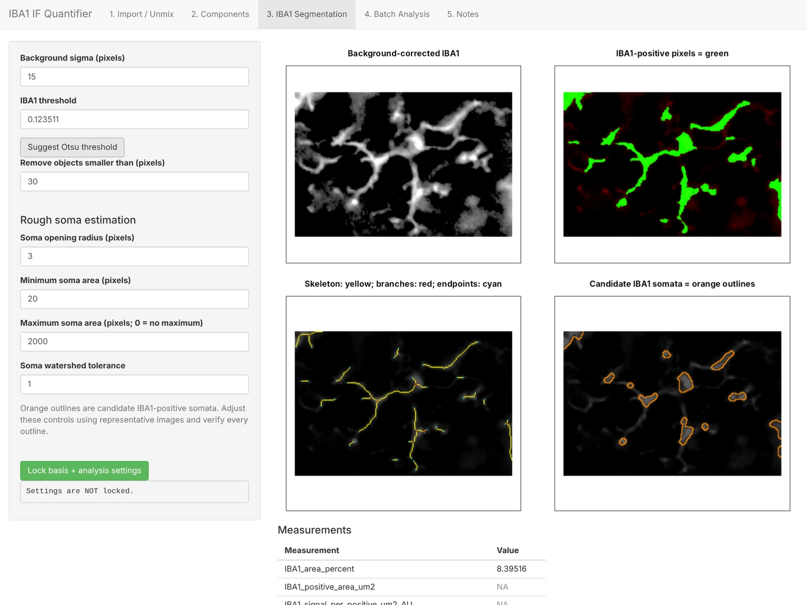
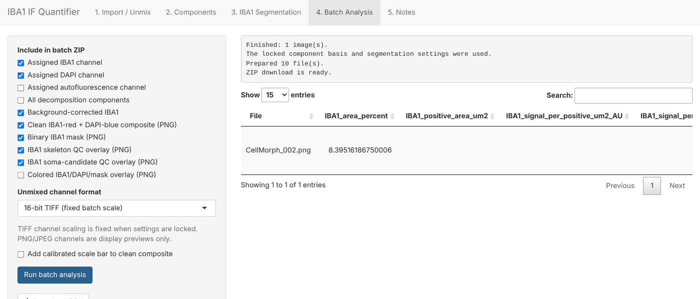

# User guide

Step-by-step instructions for the **GFAP** and **IBA1 IF Quantifier** apps. Both apps work the same way. The IBA1 app adds rough soma estimation.

---

## 1. One-time setup

### R packages
Open RStudio, set the working directory to this repository folder, and run:
```r
source("setup/install_packages.R")
```
Then go to **Session → Restart R**.

### Java (only needed for Nuance `.im3` files)
RBioFormats reads `.im3` files and needs Java. TIFF, JPG and PNG composites work without Java.

**Easiest option, no installer or admin rights needed:**
1. Go to **oracle.com/java/technologies/downloads**, open **JDK → Windows**, and download **"x64 Compressed Archive"** (`jdk-…_windows-x64_bin.zip`).
2. In **Downloads**, right-click the zip → **Extract All** → **Extract**. You should get `Downloads\jdk-26_windows-x64_bin\jdk-26\bin\…`.
3. Do **not** move or delete the extracted folder.

Both apps find Java there automatically. To confirm it works, run **Session → Restart R**, then:
```r
source("setup/java_check.R")
```
It should end with *"Java works."*

> A `.exe` file in Downloads (for example `jre-8u511-windows-x64`) is only an **installer**: Java is not installed until you run it. After installing, Java is in `C:\Program Files\Java\jre…`, which the apps also check.

---

## 2. Start an app

1. **Session → Restart R**.
2. Open `apps/GFAP_IF_Quantifier/app.R` or `apps/IBA1_IF_Quantifier/app.R`.
3. Click **Run App**.

---

## 3. Analyze images



### Tab 1: Import / Unmix
1. **Upload images**: `.im3` cubes, or composite TIFF/JPG/PNG files. You can select many at once.
2. **Representative / preview file**: choose one typical image to set up on.
3. **IM3 unmixing method**: leave on **Automatic**. If you have a Nuance spectral library (`.csv`), upload it and the app uses it (NNLS). Without a library, the app finds the components itself (NMF).
4. Keep **3 NMF components** (marker, DAPI, autofluorescence) and click **Load / decompose**.

### Tab 2: Components


Tell the app which component is the **marker** (GFAP or IBA1), which is **DAPI**, and which is **autofluorescence**. NMF component numbers are arbitrary, so decide by what each image looks like and by its spectrum. For composite images, the components are simply the Red, Green and Blue channels.

The brightness and background sliders change the **preview only**, not the measurements.

### Tab 3: Segmentation


1. **Background sigma**: 15 removes broad background glow. Leave it as is unless the mask picks up haze.
2. Click **Suggest Otsu threshold**, then adjust the **threshold** while watching the green mask. It should cover cells and processes, not background.
3. **Remove objects smaller than**: for example 20–30 pixels, to drop specks.
4. **IBA1 app only, rough soma estimation:** increase **Soma opening radius** until thin processes disappear but cell bodies remain (orange outlines). Set **min/max soma area** to exclude specks and clumps.
5. Check the **skeleton** image: yellow lines should follow the processes. Red = branch points, cyan = endpoints.
6. Click **Lock basis + analysis settings**.

### Tab 4: Batch Analysis


1. Tick what to export: channels, masks, skeleton and soma overlays, composites. You can add a scale bar if the `.im3` has calibration.
2. Click **Run batch analysis**. Every uploaded image is analyzed with the **locked** settings.
3. **Download CSV** gives the measurements, and **Download bundle** gives a ZIP of all exported images and the CSV.

---

## 4. Rules for publishable results
- Set up on a representative image, **lock**, then run **all images of all groups** in one batch with the same settings.
- **Do not** refit NMF or change the threshold per image or per group.
- Look at the skeleton and soma overlays from every group before trusting the numbers.
- Area % is the primary outcome. Skeleton and soma values are field-level descriptors (see [measurements.md](measurements.md)).
- Use animals as biological replicates, not images.

---

## Troubleshooting

| Problem | Fix |
|---|---|
| `Missing package(s): …` | Run `source("setup/install_packages.R")`, then restart R. |
| `A Windows Java JDK was not found` | Unzip a JDK into Downloads (section 1), restart R, then run `source("setup/java_check.R")`. |
| `list.files(...)` returns `character(0)` | Nothing was found at that location. Java is not installed or unzipped there. |
| `.im3` files fail but JPG/TIFF work | Java problem: see above. |
| Mask covers the background | Raise the threshold, or increase background sigma. |
| Many tiny "somas" | Increase the soma opening radius or the minimum soma area. |
